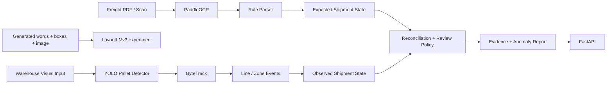

# FreightLens AI

**Multimodal Freight Document & Visual Verification System**

Convert freight documents and visual activity into expected and observed shipment states, then
report discrepancies with evidence and a human-review policy.

Python 3.11 · PaddleOCR · LayoutLMv3 · YOLO · ByteTrack · FastAPI

## Demo

```bash
uv sync --extra dev
make smoke
```

The offline demo generates a freight document expecting three pallets and a controlled video
with two line crossings. It extracts the fields, counts decoded video objects and writes a
`MISSING_PALLET` report. Offline OCR is an explicitly labeled fixture; it is not model OCR.

After running, inspect:

- [Annotated freight form](artifacts/demo/document_annotated.png)
- [Annotated tracking video](artifacts/demo/tracking_demo.mp4)
- [Shipment verification JSON](artifacts/demo/report.json)
- [Generated metric summary](artifacts/metrics/summary.json)

`make demo` runs a larger offline demonstration with seven video scenarios and 100 reconciliation
cases. Its outputs are isolated under `artifacts/demo-run/`. Open the local FastAPI interactive
documentation at [localhost:8000/docs](http://localhost:8000/docs) to exercise the service.

## Why This Project

Freight records describe expected activity; camera observations describe physical activity.
FreightLens makes the common state and the disagreement explicit. It demonstrates reproducible
data generation, document parsing, visual event abstraction and uncertainty-aware reconciliation.
It makes no claim of real warehouse deployment or measured business savings.

## Architecture



LayoutLMv3 is a separately evaluated token-classification experiment. Offline smoke replaces
OCR with labeled token fixtures and YOLO/ByteTrack with a pixel-color/centroid test tracker.
The real model paths and fixture paths expose their identity in outputs.

## What It Does

| Area | Implemented behavior |
|---|---|
| Document AI | Four form types, three layouts each; PDF/PNG/JSON; clean and degraded scans; OCR adapter; spatial label parsing; normalization; confidence; field metrics; LayoutLMv3 training/evaluation |
| Vision | Revision-pinned public RGB/NPY subset; YOLO labels; pretrained fine-tuning; held-out AP/count error; seven generated trajectory types; persistent ByteTrack; directional line/zone events |
| Reconciliation | Expected and observed schemas; count/vehicle differences; missing evidence; review policy; auditable weighted score; reproducible upstream-noise scenarios |
| Engineering | Package/CLI, FastAPI uploads, validated YAML profiles, saved experiment metadata, Docker, Ruff, mypy, pytest, offline CI and manual model workflow |

## Data

Public **synthetic** Palleset imagery supports detection. Locally generated freight forms and
controlled videos support the paired demonstration. Public **real** FUNSD forms provide separate
OCR ingestion validation and are not presented as freight data.

The default full subset is 200/60/60 images. The downloader fetches only selected RGB images and
2D box annotations, checks download size in advance and saves revision, IDs and checksums.
See [DATA_CARD.md](DATA_CARD.md) and [MODEL_CARD.md](MODEL_CARD.md).

## Results

The table below is regenerated by `make report` from saved metric JSON. Scores have different
units and evaluation scopes: parser field F1, token-entity F1, detector AP and event F1 are not
interchangeable. The pretrained model smoke runs are deliberately undertrained integration
checks. Full training is a separate command; smoke numbers are not full-training results.

<!-- RESULTS_START -->
| Component | Evaluation | Metric | Value |
|---|---|---|---|
| document_baseline | fixture_parser_only | f1 | 0.9007 |
| document_paddleocr | raster_ocr_and_parser | f1 | 0.7259 |
| tracking | fixture_pixel_tracking | crossing_f1 | 1.0000 |
| reconciliation | controlled_state_interventions | f1 | 0.9697 |
<!-- RESULTS_END -->

### Integration smoke checks

These runs only verify that the pretrained model paths load, train for one step/epoch and write
metrics end to end. They are deliberately undertrained and are not accuracy results; full-training
results (`make document`, `make vision`) are not reported here.

| Component | Smoke run | Metric | Value |
|---|---|---|---|
| pallet_detection | 1-epoch YOLO fine-tune, public_synthetic_palleset_test | mAP50 | 0.0002 |
| document_layoutlm_model_probe | 1 optimizer step, ground_truth_tokens_layout_entity_f1 | f1 | 0.0000 |
| document_layoutlm | full training | f1 | not run |

Real PaddleOCR evaluation lives in `artifacts/model-probe/metrics/document_baseline.json` and is
also copied to `artifacts/metrics/document_paddleocr.json` by the model smoke command. Model
probe JSON and run snapshots preserve real measurements even when an offline smoke rerun records
its own model stages as `not_run`. Missing or skipped metrics are not reported as zero accuracy.

## Error Analysis

- Missing or corrupted OCR numbers produce unknown fields. The fixture test preserves examples
  such as `DOC_000043` (missing weight) and `DOC_000044` (missing pallet count).
- One-epoch pallet fine-tuning misses small pallets in a crowded Palleset test image. Low-threshold
  AP and count error at the operational confidence threshold are reported separately.
- Overlapping objects can merge in fixture detections, and occlusion can fragment identities.
  Generated videos retain per-frame truth for quantitative analysis.
- A confident OCR count error can cause a false anomaly (`CASE-000014`); low-confidence evidence
  is instead routed to review. Saved JSON includes the upstream intervention and rule evidence.

See [REPORT.md](REPORT.md) for evaluation definitions, examples and compatibility decisions.

## Quick Start

Install [uv](https://docs.astral.sh/uv/getting-started/installation/), then run from this directory:

```bash
git clone https://github.com/Allan-dq/freightlens-ai.git
cd freightlens-ai
uv sync --extra dev
make smoke
make demo
make lint
```

On Windows without Make:

```powershell
uv sync --extra dev
.\scripts\tasks.ps1 smoke
.\scripts\tasks.ps1 demo
.\scripts\tasks.ps1 lint
```

The PowerShell runner also detects a local uv executable at `.tools/bin/uv.exe` when `uv` is
absent from PATH. That optional tool cache is not committed.

### Real pretrained model smoke

This downloads model weights and a tiny public subset, then runs real OCR, one LayoutLMv3 optimizer
step, one YOLO epoch and ByteTrack integration on CPU. It is intentionally separate from CI smoke.

```bash
uv sync --extra dev --extra ocr --extra layout --extra vision
uv run --no-sync python scripts/model_smoke.py
uv run --no-sync python scripts/download_funsd.py --config configs/smoke.yaml
uv run --no-sync python scripts/evaluate_funsd.py --config configs/smoke.yaml
```

### Full experiments

```bash
uv sync --extra dev --extra ocr --extra layout --extra vision
make data
make document
make vision
make reconcile
uv run --no-sync freightlens report --config configs/base.yaml
```

Full profiles use `data/full`, `models/full` and `artifacts/full`, so they do not overwrite smoke
splits or checkpoints. The default document set is 1200/200/300, the detector runs up to 30 epochs,
and LayoutLMv3 trains a frozen-backbone head with validation early stopping. CPU training is
supported but can take substantial time. Use a new data root to change an established split.

### API

```bash
uv run --no-sync uvicorn freightlens.api.app:app --host 127.0.0.1 --port 8000
```

The default API profile is `configs/base.yaml`, using full model paths. For the verified small
local checkpoint, set `FREIGHTLENS_CONFIG=configs/local.yaml` before starting the server. On
PowerShell: `$env:FREIGHTLENS_CONFIG='configs/local.yaml'`. Install model extras before analyzing
real files. Offline fixture mode deliberately rejects arbitrary document uploads.

| Method | Route | Input |
|---|---|---|
| GET | `/health` | None |
| POST | `/documents/analyze` | Multipart `file`, PDF/PNG/JPG/TIF |
| POST | `/videos/analyze?shipment_id=SHP-1` | Multipart `file`, MP4/AVI/MOV |
| POST | `/reconcile` | JSON with `expected` and `observed` shipment states |

Uploads are bounded by size, image pixels, PDF page count and video duration. The service is a
local demonstration without production authentication. Unknown counts and vehicles remain null.

```bash
docker build -t freightlens-ai .
docker compose up --build
```

The basic image provides health/reconciliation and offline pipeline dependencies. Compose enables
OCR/vision inference extras and mounts data/models/artifacts. Weights are downloaded or mounted
at runtime, not baked into the image. To build inference extras directly, pass
`--build-arg "MODEL_EXTRAS=--extra ocr --extra vision"`.

### CLI examples

```bash
freightlens version
freightlens data generate-documents --config configs/smoke.yaml
freightlens document analyze document.pdf --config configs/local.yaml
freightlens document evaluate --backend rules --config configs/smoke.yaml
freightlens vision detect pallet.png --config configs/local.yaml
freightlens vision track pallets.mp4 --config configs/local.yaml
freightlens reconcile --expected expected.json --observed observed.json
freightlens demo --config configs/smoke.yaml
```

## Repository Structure

```text
configs/              Validated smoke, demo, full and local API profiles
src/freightlens/       Schemas, data, document_ai, vision, reconciliation, api, CLI
scripts/              Phase entrypoints, model smoke and Windows task runner
tests/                Unit tests and offline/optional model integration tests
data/manifests/        Dataset revisions, splits, file hashes and download records
data/{raw,synthetic,processed}/
models/{document,vision}/
artifacts/{metrics,figures,predictions,videos,demo,runs}/
```

## Reproducibility

Seeded generation, stable IDs, immutable split manifests, ground-truth JSON hashes and a checked-in
`uv.lock` define the experiment inputs. Each measured stage records config, environment, seed,
timestamp, Git revision when available and metrics in `artifacts/runs/`. Generated large outputs
and weights are ignored by Git. Run `make report` to refresh the measured table from JSON.

Standard CI installs only core/dev dependencies and uses offline fixtures. A manual workflow runs
pretrained model integration. JSON serialization rejects nonfinite metrics. Confidence scores are
heuristics, not calibrated probabilities.

## Limitations

No proprietary records or real warehouse deployment were used. Freight forms, warehouse imagery
and paired videos are generated or simulated, and unseen documents/cameras may behave differently.
Rule scenario evaluation uses controlled interventions rather than naturally paired operations.
The small verified training runs establish working integration, not deployment-level accuracy.

Project source is AGPL-3.0-or-later. External weights and data keep their own licenses;
**LayoutLMv3's CC BY-NC-SA 4.0 noncommercial restriction remains in force**.

## Future Work

Complete larger training runs, test unseen layouts and cameras, calibrate confidence and validate
with appropriately licensed real warehouse observations. Plate recognition, learned anomaly
scoring and a review dashboard are intentionally outside the implemented core.
