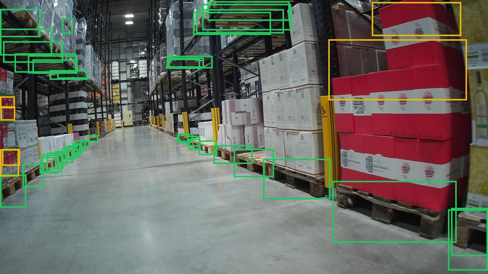
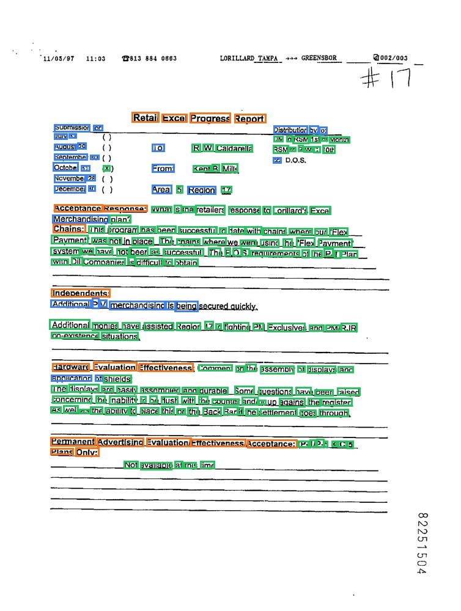
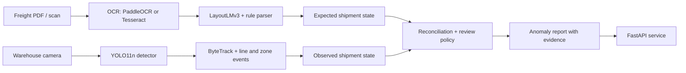

# FreightLens AI

[](https://github.com/Allan-dq/freightlens-ai/actions/workflows/ci.yml)
[](LICENSE)


**Freight document and warehouse-camera verification.** FreightLens reads what a shipment's
paperwork says, counts what the camera actually sees, and reports the differences with evidence.



<sub>YOLO11n detections on a LOCO test image from a recording session never seen in training.
Green: pallets, yellow: small load carriers. The large carton stack on the right is a typical
error: it is tagged as small load carriers.</sub>

## Results on real public data

Both models are fine-tuned on real, public datasets and scored once on held-out test splits.
The table is generated from the saved metric files by `freightlens report-real`.

<!-- REAL_RESULTS_START -->
| Model | Trained on | Evaluated on | Metric | Value |
|---|---|---|---|---|
| YOLO11n detector | LOCO, 1,943 real warehouse images | LOCO, 2,277 images from unseen recording sessions | pallet AP50 | 0.522 |
| YOLO11n detector | | | pallet AP50-95 | 0.206 |
| YOLO11n detector | | | mAP50, all 5 classes | 0.271 |
| YOLO11n detector | | | pallet count MAE per image | 7.22 |
| LayoutLMv3-base, word boxes (OCR setting) | FUNSD, 134 scanned forms | FUNSD official test, 50 forms | entity F1 | 0.797 |
| LayoutLMv3-base, segment boxes | FUNSD, 134 scanned forms | FUNSD official test, 50 forms | entity F1 | 0.878 |
| YOLO11n, 640 px | | Apple M1 Pro, cpu | median latency | 36 ms |
| YOLO11n, 640 px | | Apple M1 Pro, mps | median latency | 19 ms |
| LayoutLMv3-base, 512 tokens | | Apple M1 Pro, cpu | median latency | 263 ms |
| LayoutLMv3-base, 512 tokens | | Apple M1 Pro, mps | median latency | 151 ms |
<!-- REAL_RESULTS_END -->

- **LOCO** ([tum-fml/loco](https://github.com/tum-fml/loco), CC0) contains photos taken while
  walking through real logistics facilities. Train, validation and test come from different
  recording sessions, so near-duplicate frames never leak across splits.
- **FUNSD** is the standard benchmark for understanding noisy scanned forms. *Word boxes* give each
  word its own box, as an OCR engine would on a new document. *Segment boxes* give every word its
  annotated entity box, the setting used for the published LayoutLMv3 FUNSD score (90.3 F1); that
  setting relies on ground-truth entity extents and is reported only for comparison.



### Error analysis

- **Distant pallets are missed.** Test images hold 23 pallets on average (median 16), many only a
  few pixels tall after resizing 1920×1080 frames to 640 px. Overall recall is the weak side, and
  the per-image pallet count is off by 7.2 on average. Training at a higher input resolution is
  the next experiment.
- **Rare classes are unstable.** Forklifts and pallet trucks have a few hundred training boxes
  each, against 57,000 pallets, and their AP stays low.
- **Large carton stacks look like small load carriers** at a distance, as in the image above.
- **Form headers are the hardest entity** on FUNSD (fewest examples), while questions and
  answers are labeled reliably (right: blue questions, green answers, orange headers).

<br clear="right">

## How it works



| Area | What is implemented |
|---|---|
| Documents | PDF/PNG ingestion, OCR adapters, LayoutLMv3 token classification, spatial rule parser with unit normalization and confidence |
| Vision | YOLO11n detection (LOCO classes), ByteTrack tracking, directional line and zone crossing events, pallet counting |
| Reconciliation | Expected vs. observed shipment states, count and vehicle checks, missing-evidence handling, human-review routing |
| Engineering | Typed config with inheritance, CLI, FastAPI with upload limits, Docker, recorded runs (config, seed, versions, Git revision), Ruff, mypy, pytest, CI |

## Quick start

Requires [uv](https://docs.astral.sh/uv/getting-started/installation/).

```bash
git clone https://github.com/Allan-dq/freightlens-ai.git
cd freightlens-ai
uv sync --extra dev
make smoke   # offline end-to-end run on generated fixtures, no downloads
make lint test
```

## Reproduce the real-data results

```bash
uv sync --extra dev --extra layout --extra vision

# Detector: download LOCO (769 MB archive + COCO annotations) into data/full/raw/loco, then
uv run --no-sync freightlens data prepare-loco --config configs/real.yaml
uv run --no-sync freightlens vision train --config configs/real.yaml

# Form model
uv run --no-sync freightlens data download-funsd --config configs/real.yaml
uv run --no-sync freightlens document train-funsd --config configs/real.yaml
uv run --no-sync freightlens document train-funsd --config configs/real_segment.yaml

# Latency and README table
uv run --no-sync python scripts/benchmark_latency.py --config configs/real.yaml
uv run --no-sync freightlens report-real --config configs/real.yaml
```

`configs/real.yaml` picks CUDA, Apple MPS or CPU automatically. Every measured stage writes its
config, environment, seed and Git revision to `artifacts/full/runs/`. Dataset provenance and
licenses are in [DATA_CARD.md](DATA_CARD.md); model details in [MODEL_CARD.md](MODEL_CARD.md).

## Demo app

`space/` contains a Gradio app with two tabs, warehouse object detection and form understanding,
ready to deploy as a Hugging Face Space. Example inputs are taken from the LOCO and FUNSD test
splits.

## API

```bash
uv run --no-sync uvicorn freightlens.api.app:app --host 127.0.0.1 --port 8000
```

| Method | Route | Input |
|---|---|---|
| GET | `/health` | None |
| POST | `/documents/analyze` | Multipart `file`, PDF/PNG/JPG/TIF |
| POST | `/videos/analyze?shipment_id=SHP-1` | Multipart `file`, MP4/AVI/MOV |
| POST | `/reconcile` | JSON with `expected` and `observed` shipment states |

Uploads are bounded by size, pixel count, PDF page count and video duration. `docker compose up
--build` runs the service with OCR and vision extras; weights are mounted at runtime.

## Pipeline checks on generated data

The end-to-end pipeline (parser, tracking, reconciliation) is also tested on locally generated
freight forms and controlled videos with exact ground truth. These numbers measure the logic on
synthetic inputs, not real-world accuracy. See [REPORT.md](REPORT.md) for definitions.

<!-- RESULTS_START -->
| Component | Evaluation | Metric | Value |
|---|---|---|---|
| document_baseline | fixture_parser_only | f1 | 0.9007 |
| document_paddleocr | raster_ocr_and_parser | f1 | 0.7259 |
| tracking | fixture_pixel_tracking | crossing_f1 | 1.0000 |
| reconciliation | controlled_state_interventions | f1 | 0.9697 |
<!-- RESULTS_END -->

## Repository layout

```text
configs/            smoke, base, real-data and API profiles
src/freightlens/    document_ai, vision, reconciliation, api, schemas, CLI
scripts/            training, evaluation, benchmark and demo entry points
space/              Gradio demo for Hugging Face Spaces
tests/              unit and integration tests
data/manifests/     dataset revisions, splits and checksums
```

## Limitations

- LOCO covers five facilities filmed from a walking camera; fixed overhead dock cameras, other
  pallet types and night lighting are not represented.
- FUNSD forms are not freight documents. The freight-form extractor is trained only on generated
  layouts, so it is not yet validated on real bills of lading.
- Tracking and reconciliation are evaluated on controlled videos and generated shipments, not on
  paired real operations.

## License

Source code is AGPL-3.0-or-later. Datasets and pretrained weights keep their own terms;
LayoutLMv3 weights are CC BY-NC-SA 4.0 (non-commercial).
