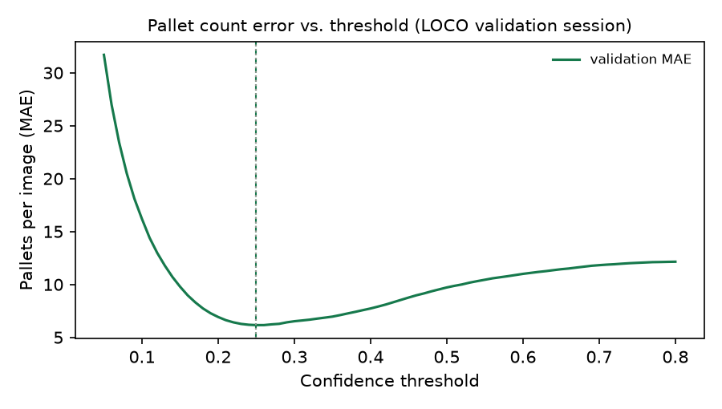

# FreightLens AI technical report

## 1. Problem

Documents describe expected freight; videos show observed activity. The project converts both
into validated shipment states and exposes discrepancies with explicit uncertainty and evidence.

## 2. Data

The freight forms are locally generated, Palleset is public synthetic warehouse imagery, and
FUNSD supplies separate real scanned-form validation. These categories are never pooled into
a claim about real freight operations. Full and smoke profiles have separate data roots. The
larger offline demo also uses its own root to prevent stale split files contaminating metrics.
See [DATA_CARD.md](DATA_CARD.md) for source terms, selective download and attribution.

## 3. Document AI

Twelve original layouts cover four document types. ReportLab supplies vector PDFs, PDFium renders
the image, and a seeded OpenCV degradation pipeline records image-space transforms. Both clean
and noisy images are saved. Word labels stay aligned after rotation/perspective changes.

PaddleOCR line detections are split into approximate word boxes. The rule parser groups spatial
lines, matches labels, finds neighboring values and normalizes numbers and units. A fixture OCR
backend injects controlled token corruption for repeatable offline tests; its metrics are
parser tests, not measured raster OCR robustness.

LayoutLMv3 uses a frozen pretrained backbone and a small BIO head. Training shuffles with a fixed
seed, evaluates validation each epoch, stops on patience, reloads the best checkpoint and evaluates
the held-out test set. Ground-truth tokens are used to isolate the layout experiment. The smoke
checkpoint is undertrained and must not be marketed as an accurate freight extractor.

## 4. Computer vision

The selective Palleset downloader was exercised on real public RGB/NPY files. Upstream train and
validation membership is preserved. YOLO11n was initialized from pretrained weights, adapted to
one pallet class, trained for the smoke epoch and evaluated on held-out imagery. Counting uses
the configured confidence threshold, while AP integrates detection confidence thresholds.

Controlled videos cover normal crossing, two close pallets, temporary occlusion, partial travel,
overlap, reverse direction and crowding. The offline tracker operates on decoded pixels, never
ground-truth track IDs. The learned path uses YOLO plus Ultralytics ByteTrack with persistent
per-video state. ByteTrack's identity association is additionally exercised using known detector
boxes without model downloads. Directional line counting deduplicates each track and tolerates
a frame exactly on the line. Zone entry/exit events are independent.

## 5. Multimodal reconciliation

The demo derives expected state from extraction and observed state from actual crossing events.
It compares three expected pallets with the two-pallet generated sequence. Vehicle identity is
left unknown unless explicitly supplied; it is not inferred from the document.

Batch rule evaluation applies audited state interventions because public documents and videos
are not naturally paired. Original video count, aligned count, source document and noise are
stored. A combined count and vehicle discrepancy is labeled `COUNT_MISMATCH`, with both individual
discrepancies retained in evidence. Low-confidence or incomplete evidence returns
`REVIEW_REQUIRED` and does not force an anomaly decision.

## 6. Evaluation

This table is regenerated from saved JSON by `make report`. Fixture field F1, layout entity F1,
detector AP, tracking event F1 and rule-classification F1 measure different tasks.

<!-- RESULTS_START -->
| Component | Evaluation | Metric | Value |
|---|---|---|---|
| document_baseline | fixture_parser_only | f1 | 0.9007 |
| document_layoutlm | not_run | f1 | not run |
| pallet_detection | public_synthetic_palleset_test | mAP50 | 0.0002 |
| tracking | fixture_pixel_tracking | crossing_f1 | 1.0000 |
| reconciliation | controlled_state_interventions | f1 | 0.9697 |
| document_paddleocr | raster_ocr_and_parser | f1 | 0.7259 |
| document_layoutlm_model_probe | ground_truth_tokens_layout_entity_f1 | f1 | 0.0000 |
<!-- RESULTS_END -->

Detailed metrics include field/type/degradation breakdowns, all-fields-correct, CER, detector
precision/recall/AP/count MAE, event precision/recall, ID switches, fragmentation, confusion matrix,
per-class F1, ROC/PR AUC where defined and review accuracy. Real PaddleOCR held-out results are
saved separately under `artifacts/model-probe/metrics/document_baseline.json`; FUNSD has its own
`artifacts/metrics/funsd_ocr.json`. The few-step trained-model results are integration evidence,
not completion of the full configured training experiment.

## 7. Error analysis

- In the fixture test, `DOC_000043` loses the numeric weight token and retains only the unit; the
  parser leaves weight unknown. `DOC_000044` loses the pallet number. Both examples are saved in
  `artifacts/predictions/document_errors.json` with OCR text and expected/predicted values.
- Severe degradation and line grouping can split the title or confuse adjacent fields. Unknown
  document titles receive zero extraction confidence. The fixture corruption protocol is not a
  measured model response to pixel degradation; real OCR results are reported separately.
- The initial Palleset test image is crowded with small annotated pallets. The one-epoch detector
  misses the pallets at the counting threshold. The annotated image and exact expected/predicted
  counts are saved with detector evaluation. More data/training is needed before using this
  checkpoint to draw operational conclusions.
- Overlapping composites can merge in the pixel fixture detector; occlusion can create identity
  fragmentation. The seven-scenario demo exposes these limits rather than supplying GT IDs to
  the tracker. ID-switch and fragmentation calculations are tested against deliberately changed IDs.
- `CASE-000014` injects a confident wrong OCR pallet count into an otherwise normal shipment. The
  rules flag a missing pallet, showing an upstream-error false positive. Lower-confidence cases
  correctly route to review. Complete case evidence is in `reconciliation_errors.json`.

## 8. Engineering validation and deviations

The core CPU environment is `uv sync --extra dev`. Model stacks are explicit `ocr`, `layout` and
`vision` extras so offline CI does not download weights or GPU dependencies. Python 3.11 and a
generated `uv.lock` are used. No test-specific metrics are substituted for model results.

The installed PaddleOCR 3 API uses `predict()` and `rec_texts/rec_polys/rec_scores` rather than the
older nested `ocr()` output. Windows Paddle 3.3.1 hit an unsupported oneDNN PIR operation, so the
adapter explicitly disables MKLDNN; the real image inference then succeeded. See the
[official OCR interface](https://www.paddleocr.ai/main/en/version3.x/pipeline_usage/OCR.html).
Paddle's current English default resolves to PP-OCRv6 medium models in this locked environment.

Transformers is bounded to the validated 4.x API; training uses a small explicit PyTorch loop.
See [LayoutLMv3 processor documentation](https://huggingface.co/docs/transformers/en/model_doc/layoutlmv3).
NumPy scalars from seqeval are converted to JSON numbers; nonfinite metrics are rejected.
YOLO11n is an explicitly configurable supported checkpoint, and ByteTrack is explicitly selected
because the current Ultralytics default tracker differs. See
[Ultralytics tracking](https://docs.ultralytics.com/modes/track/).

PDFium replaces a system Poppler requirement for the generator's rendering step, preserving
cross-platform raster/annotation alignment. Multi-page uploads are bounded and their OCR tokens
keep page IDs. Upload handlers cap extensions, bytes, rendered image pixels and video duration.

Linux `Makefile` and Windows `scripts/tasks.ps1` expose equivalent smoke, demo, lint and test paths.
FastAPI unit/integration tests exercise all endpoints, invalid state payloads, upload limits and
actual video decoding. Docker Desktop was started and the CPU service image successfully built
locally. The inference dependencies remain optional build arguments; model training is performed
outside the image. Ultralytics 8.4's direct ByteTrack constructor no longer takes `frame_rate`;
the direct association test uses the installed configuration API.

## 9. Limitations and future work

No proprietary operational data or production warehouse deployment is represented. Generated
freight forms, synthetic pallet imagery, controlled videos and public-data domain gaps limit the
conclusions. Performance may degrade on unseen warehouse cameras and documents. A small smoke
training run proves integration only. Next steps are the full reproducible experiments, held-out
template/camera validation, confidence calibration and a human review workflow. No business cost
or productivity claims are made.

## 10. Real-data training (LOCO and FUNSD)

**Detector.** YOLO11n (COCO-pretrained) is fine-tuned on LOCO, real photos from logistics
facilities released under CC0. LOCO is recorded as continuous walks, so neighbouring frames are
near-duplicates; splitting by frame would leak them across splits. Splits are therefore whole
recording sessions: sessions 2 and 3 for training (1,943 images), session 5 for checkpoint
selection (877) and sessions 1 and 4, LOCO's official validation sessions, for the single final
test (2,277). Training used 640 px inputs, batch 16, up to 50 epochs with early stopping on
validation fitness (stopped after epoch 47, best epoch 37) on an Apple M1 Pro (MPS).

**Form model.** LayoutLMv3-base is fine-tuned end to end on FUNSD for 1,000 steps (AdamW, learning
rate 1e-5, 10 % linear warm-up, batch 2). Fifteen of the 149 training forms are held out to pick
the checkpoint; the official 50 test forms are scored once with seqeval entity F1. Two box
conventions are reported: word boxes, which an OCR engine produces on new documents, and segment
boxes, which reuse annotated entity extents and match the protocol of the published result.

**Reading the numbers.** The measured values are in the README table, rendered from
`artifacts/full/metrics/` by `freightlens report-real`. Detection AP is averaged over confidence
thresholds, while the pallet count error uses the operating threshold of 0.25, so the two can
move independently. The main detector weakness is recall on small, distant pallets at 640 px;
the next experiment is training at a higher input resolution.

**Counting threshold.** AP summarizes all confidence thresholds, but counting needs one operating
point. `freightlens vision calibrate` caches pallet predictions at confidence 0.01, sweeps 0.05 to
0.80 on the validation session and keeps the threshold with the lowest mean absolute count error;
the test sessions are then scored once at that threshold. The sweep selected 0.25, so the default
was already the best operating point. On the test sessions the count error is 7.2 pallets per
image with a mean bias of −0.9, which shows that misses and false positives largely offset each
other rather than the model systematically undercounting.

**Does resolution limit the detector?** Before training at a higher input size, tiled inference
measured the headroom without retraining: the 640 px model also runs on overlapping 960 px crops
(scaled to 640, about 2x the effective resolution) plus the full frame, and the boxes are merged
with class-wise NMS (`scripts/evaluate_tiling.py`). All modes share one evaluator that mirrors the
Ultralytics matching and AP code; on the full-frame mode it reproduces the official pallet AP50
(0.410 vs 0.412 on validation, 0.519 vs 0.522 on test). Modes and counting thresholds were chosen
on the validation session, and the test sessions were scored once.

| Mode | Val pallet AP50 | Test pallet AP50 | Test pallet AP50-95 | Test count MAE / bias |
|---|---|---|---|---|
| Full frame, 640 px | 0.410 | 0.519 | 0.200 | 7.2 / -0.9 |
| 960 px tiles + full frame | 0.467 | 0.531 | 0.201 | 8.3 / -5.8 |
| 640 px tiles + full frame | 0.440 | not run | | |

Higher effective resolution helps a lot on the validation session (+0.057 AP50) but only a little
on the test sessions (+0.012, with no change in AP50-95), so the gain depends on how far away the
pallets are in a given facility. The counting threshold chosen on validation (0.37 for tiles)
undercounts badly on test: a single counting threshold does not transfer across sites, so
counting would need per-site calibration. The deployed model stays at full-frame 640 px.
